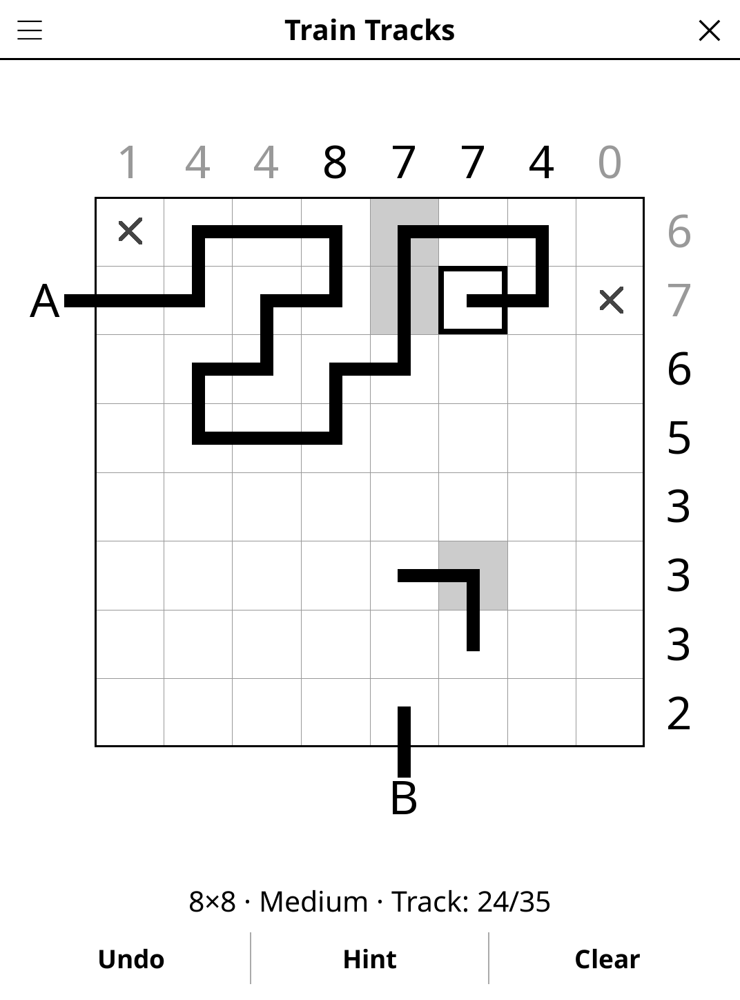

# tracks.koplugin

A Train Tracks puzzle for [KOReader](https://github.com/koreader/koreader),
after Simon Tatham's "Tracks".

## Screenshot

## Rules

Lay a single railway from the entrance **A** (left edge) to the exit **B**
(bottom edge). Every cell is either empty or holds one piece of track joining
two of its sides, straight or curved; the track never branches or crosses
itself. The numbers above the columns and right of the rows say how many cells
of that line the track passes through. Grey cells are given pieces.

## Features

- **Five grid sizes** — 6×6 to 10×10
- **Three difficulty levels**, measured by the solver rather than by the
  number of givens:
  - *Easy* — solvable with piece rules (a track cell has exactly two exits)
    and line counts alone;
  - *Medium* — also needs connectivity reasoning (no closed loop, the run
    from A may only meet the run from B once it holds every track cell);
  - *Hard* — the same reasoning as Medium, but many more connectivity
    steps (Medium has a ceiling on them). No level ever needs trial and
    error.
- **Unique solution, always** — the generator solves every grid by deduction
  and also counts solutions exhaustively before shipping it.
- **Hint** — two taps: the first points at a cell, the second lays its piece
  (or clears a wrong one first).
- **Undo**, **Clear**, **Show solution**, **timer**, **auto-save**.
- Clue numbers turn grey when their line has exactly enough track, and white
  on black when it has too much.

## Controls

| Action | How |
|--------|-----|
| Select a cell | Tap it |
| Lay / lift the rail to a neighbour | Tap the neighbour (it becomes the selection, so a track is drawn by tapping its cells in turn) |
| Deselect | Tap the selected cell again |
| Mark a cell "no track" | Hold it |
| Undo / Clear | **Undo** / **Clear** |
| Size, difficulty, solution, rules | Title-bar menu |

## Generator

A random simple path from A to B is grown by local deformations (pushing a
straight pair sideways, flipping corners) from a random three-bend route, to
42–58 % of the grid. Givens are added where the solver gets stuck (picking up
from the stuck position each time), then removed again while the grid stays
solvable within the difficulty's tier; Medium and Hard then keep a path only
if the grid needs the right number of connectivity steps. The exhaustive count
that double-checks uniqueness has a node budget, and a grid that would exceed
it is replaced. Over 100 seeds per size and level on a desktop (LuaJIT): under
0.01 s on average, about 0.04 s at worst (9×9 Hard). A progress bar appears if
generation runs longer than a fraction of a second (an e-reader is about 25×
slower). Every limit is a count, never the clock, so a seed — like the Daily
Challenge's — gives the same grid on every device.

## License

GPL-3.0 — see [LICENSE](LICENSE).
